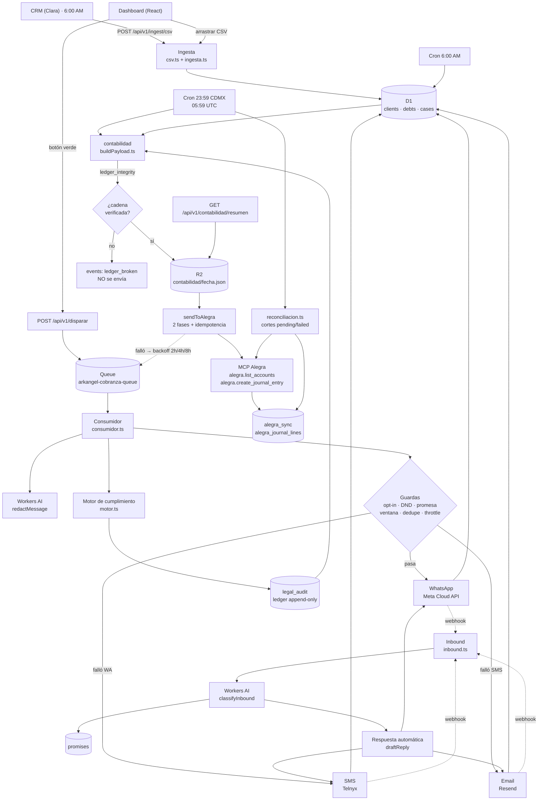

# Arquitectura — Arkangel

## Diagrama de flujo



## Motor de cumplimiento: la ley como código

Cada contacto (salida **y** respuesta automática) pasa por `src/legal/motor.ts` antes de
llegar al proveedor. El catálogo legal vive en `src/legal/reglas.ts`: cada conducta es un
evaluador puro que devuelve la violación o `null`.

```
mensaje IA → [1.1] [1.2] [2.1] [3.1] [4.4] detección + reparación
           → [2.3] [2.4] [3.2] [4.2] [5.2] [8.1] [8.7] verificación
           → BLOCK | SANITIZE | WARN | ESCALATE → auditoría
```

| Regla | Conducta | Acción | Mecanismo |
|---|---|---|---|
| 1.1 | Usurpación de identidad corporativa | SANITIZE | se agrega la razón social + registro CONDUSEF; si no hay razón social configurada → **BLOCK** (fail-closed) |
| 1.2 | Representación sin poder legal | SANITIZE | se elimina la frase que presenta al agente como abogado |
| 2.1 | Amenaza fuera de proceso | SANITIZE | se elimina la frase con amenaza de embargo/juicio/policía |
| 2.3 | Hostigamiento continuo | BLOCK | más de 3 impactos en 24 h (conteo real en D1) |
| 2.4 | Horario prohibido | BLOCK | fuera de 08:00–22:00 CDMX (NOM-184-SCFI-2012, 5.1.2) |
| 3.1 | Smishing link apócrifo | SANITIZE | se eliminan URLs fuera de la allowlist de dominios |
| 3.2 | QR de pago no trazable | BLOCK | toda CLABE del mensaje debe coincidir con `contracts.clabe` |
| 4.2 | Interés sobre interés no pactado | BLOCK | el monto mostrado no puede exceder lo pactado |
| 4.4 | Extorsión por contactos | SANITIZE | se elimina la amenaza de difundir el adeudo |
| 5.2 | Simulación de orden judicial | BLOCK | ningún documento con apariencia judicial |
| 8.1 | Monto contrato vs CRM | BLOCK | el monto del CRM debe igualar el del contrato |
| 8.7 | Falsedad de registros | BLOCK | lo declarado por el CRM debe igualar los logs reales |

**Fail-closed**: si una conducta persiste tras la reparación, la acción sube a `BLOCK` y el
mensaje no sale. No se "lava" un mensaje inválido por otro canal: el caso pasa a `human`.

**Excepciones justificadas**: la regla 2.3 y la 2.4 no se aplican a una *respuesta* a un
mensaje del deudor (responder no es hostigamiento). Se activa el criterio estricto con
`LEGAL_HORARIO_EN_RESPUESTAS=true`.

**Auditoría**: cada violación queda en `legal_audit` con `regla_id`, `ley`, `articulo`, `castigo`,
`detalle`, `evidencia` y el mensaje involved — evidencia reutilizable en unProcedure
administrativo ante CONDUSEF o PROFECO.

## Módulo contable: del compliance a Alegra

El mismo `legal_audit` que alimenta el expediente de CONDUSEF/PROFECO alimenta el
contabilidad: cada violación se traduce en un asiento y se manda a Alegra por MCP.

### Flujo

1. **Cron 23:59 CDMX** (`59 5 * * *` UTC → `src/cron/contabilidadDaily.ts`): corta
   el **día hábil de CDMX anterior** (cerrado de punta a punta) y, antes, corre la
   **reconciliación** de los cortes que quedaron a medio camino.
2. **`buildAccountingPayload(fecha, env)`** (`src/contabilidad/buildPayload.ts`):
   - lee `legal_audit` del día (el ledger), `contracts`, `messages` y `cases`;
   - arma la **cadena de hashes** del ledger (cada eslabón depende del anterior) y
     la contrasta con `ledger_checkpoint` → `ledger_integrity.verificado`;
   - hace el JOIN con `legal_accounting_map` (regla → cuentas);
   - reconoce ingreso sólo con mensajes en `delivered` / `read` / `promise_made`;
   - valida el JSON con **Zod** (`src/contabilidad/schemas.ts`); si no valida, no
     se guarda ni se manda.
3. **R2**: el payload normalizado queda en `contabilidad/{fecha}.json`.
4. **`sendToAlegra(payload, env)`** (`src/contabilidad/sendToAlegra.ts`), en dos fases:
   - `alegra_sync` se inserta `pending` **antes** de llamar a Alegra;
   - `alegra.list_accounts` (cache 24 h en KV) → valida cuentas; las inexistentes
     se sustituyen por la cuenta de *Provisión por Contingencia Legal* con evento
     accionable `alegra_account_fallback`;
   - un `alegra.create_journal_entry` por asiento, cada uno con la referencia
     `legal_audit:{id} | ledger:{hash}`;
   - `alegra_journal_lines` se escribe **antes** del `UPDATE` a `alegra_sync`
     (si ese UPDATE falla, la reconciliación encuentra la línea y no re-asienta);
   - si falla, reencola el mismo payload con backoff **2 h → 4 h → 8 h** (máx. 3
     intentos) y después deja la fila en `failed`.

### Reconciliación (`src/cron/reconciliacion.ts`)

Cortes en `pending`/`failed` → se consulta `alegra.list_journal_entries` por
`idempotency_key`:

| Situación | Acción |
|---|---|
| Sin líneas | no se creó nada → reenvío del corte desde R2 |
| Todo existe en Alegra | `status = 'reconciled'`, sin duplicar |
| Falta algún asiento | se re-crea sólo ese; los demás se omiten |
| No se puede confirmar | **no** se re-asienta: aviso `alegra_reconciliacion_sin_confirmacion` |

### Decisión CFDI vs. provisión

| Caso | Asiento |
|---|---|
| Hay CFDI timbrado (`contract_cfdi.cfdi_uuid`) | asiento **vinculado al CFDI**: `cfdi_relacionado` = UUID |
| No hay CFDI (lo normal: el bloqueo impidió timbrar) | asiento **"Provisión sin CFDI"**: `cfdi_relacionado` = `null` |

### Trazabilidad

```
legal_audit.id ──► asiento.legal_audit_id + asiento.referencia_ledger
                └► alegra_journal_lines.alegra_journal_id
                └► alegra_sync.alegra_journal_id
```

### Fail-closed

- `ledger_integrity.verificado === false` → **no se envía**; se alerta con
  `events` tipo `ledger_broken`.
- `legal_audit` y `events` son **append-only**: el módulo sólo los lee (jamás
  `UPDATE` ni `DELETE`).
- El corte es el **día hábil de CDMX cerrado** (ventana UTC semiabierta
  `06:00Z → 06:00Z`), no un día UTC partido: así la ventana de contacto
  08:00–22:00 nunca se parte entre dos cortes.

## Frontend y design system

El panel es una SPA React servida como static assets del propio Worker (`assets` binding).
Todo el UI se compone con el design system del repo (`design-system/`), que es **código
compartido** (tokens + preset Tailwind + componentes presentacionales) pensado para que el
próximo proyecto Arkangel lo adopte sin rediseñar:

| Pieza | Ubicación |
|---|---|
| Tokens (color, tipografía, radio, sombra, patrones) | `design-system/tokens.css` |
| Preset Tailwind (`ark.*`, `rounded-card`, `shadow-card`) | `design-system/tailwind.preset.js` |
| Componentes (`PageShell`, `TopNav`, `KpiCard`, `DataTable`, `DarkPanel`, `Dropzone`…) | `design-system/components.tsx` |
| Marca de agua institucional (PNG + SVG) | `scripts/forge_arkangel_watermark.py` → `frontend/public/assets/` |

Regla estructural: **el design system no sabe nada del dominio**. Los datos reales entran por
props; los componentes no hacen `fetch`. Así el mismo set sirve para el panel de cobranza,
conciliación, fiscal o comercial.

El panel consume `GET /api/v1/cases/today` (estado, último canal, intención detectada por IA
y próxima acción por caso) y `GET /api/v1/metrics/today` (KPIs + `por_estado`), y expone el
mismo catálogo legal en `GET /api/v1/legal/catalogo`.

El panel entra con **identidad nativa**: `AuthProvider` (`frontend/src/auth/AuthContext.tsx`)
hace un bootstrap silencioso contra `GET /api/auth/session`; si la cookie `ark_session` sigue
viva, entra al panel; si no, `AuthGate` (`frontend/src/auth/AuthGate.tsx`) pide correo y
contraseña. La cookie es `HttpOnly`, así que la SPA no puede leerla: sólo mandarla, con
`credentials: 'include'`. Un 401 devuelve al acceso; un 403 muestra el motivo (despacho ajeno,
sin permiso). El selector de despacho de la barra superior cambia el tenant activo sin cerrar
sesión: sólo mueve la cabecera `X-Tenant-Id`, y el Worker comprueba que el usuario sea miembro
de ese despacho.

## Modelo de datos (D1)

| Tabla | Qué guarda | Claves |
|---|---|---|
| `clients` | datos de contacto y opt-ins | `id`; dedupe por `phone`, `curp` único |
| `debts` | saldo pendiente por cliente | `id`; índice `(client_id, status)` |
| `cases` | caso de cobranza del día | `id`; único `(client_id, case_date)` |
| `messages` | bitácora outbound/inbound por canal | `id`; índices por `case_id`, `provider_id` |
| `promises` | promesas de pago detectadas por la IA | `id`; índice `(client_id, status)` |
| `events` | auditoría de cada acción | `id`; índice `(type, created_at)` |
| `intakes` | receivable de cada CSV ingested | `id` |
| `contracts` | monto pactado, CLABE y razón legal por cliente | `id`; índice `client_id` |
| `legal_audit` | bitácora de cumplimiento (regla, ley, artículo, castigo, evidencia) | `id`; índices por fecha y regla |
| `alegra_sync` | corte enviado a Alegra (idempotency key, estado, journal id) | `id`; `idempotency_key` único |
| `legal_accounting_map` | mapa regla legal → cuentas contables de Alegra | `regla_id` |
| `alegra_journal_lines` | trazabilidad asiento por asiento (`legal_audit.id` → journal id) | `(idempotency_key, legal_audit_id)` |
| `ledger_checkpoint` | cabeza de la cadena de hashes del ledger por día | `fecha_corte` |
| `contract_cfdi` | UUID del CFDI timbrado por contrato (opcional) | `contract_id` |
| `tenants` | catálogo de clientes: identidad legal, ventana, límites, modo de config | `id`; `slug` único; un solo `is_default` |
| `tenant_channels` | enrutado y credenciales por canal | `(channel, provider_account_id)` único |
| `tenant_accounting_map` | mapa regla legal → cuentas, por tenant | `(tenant_id, regla_id)` |
| `users` | identidad humana: correo, hash PBKDF2, rol de plataforma | `id`; `email` único (sin distinguir mayúsculas) |
| `tenant_memberships` | **rol** del usuario dentro de cada despacho | `(user_id, tenant_id)`; `role` con CHECK (`owner`/`admin`/`member`) |
| `auth_sessions` | sesiones activas: `token_hash` (SHA-256), caducidad y revocación | `token_hash` |
| `auth_tokens` | tokens de un solo uso (restablecer contraseña) | `token_hash` |
| `auth_rate_limits` | ventana de intentos de acceso por correo e IP | `bucket_key` |

`opt_in` es **triestado**: `1` = acepta, `0` = rechaza explícito, `NULL` = desconocido
(se permite el primer contacto a WhatsApp/SMS; el email exige `1`).

## Multi-tenant

Cada tenant es una **empresa de cobranza**: tiene su propia razón social, su
registro ante CONDUSEF, sus dominios de pago, su ventana de contacto y sus
límites. El Worker es la plataforma; el tenant es el cliente.

### El contexto manda

El aislamiento no se apoya en que cada consulta recuerde su `WHERE`: se apoya
en que **el contexto travels explícito en la firma**.

```ts
export interface TenantContext {
  env: Env;
  tenantId: string;
  tenant: Tenant;
  config: TenantConfig;   // identidad legal + límites + operativa, ya resueltos
  channels: TenantChannel[];
  principal: Principal;   // quién pregunta y con qué scopes
}
```

`configLegal(ctx)` —no `configLegal(env)`— es lo que garantiza que la razón
social que se imprime al pie del mensaje (regla 1.1) sea la del tenant que
emite. D1 no tiene RLS, así que el aislamiento depende de que **ningún
servicio pueda tocar la base sin un contexto**.

### De dónde sale la configuración

| Modo | Fuente | Uso |
|---|---|---|
| `db` | la fila de `tenants` | modo normal. Fail-closed: lo que no está, no se inventa |
| `platform_env` | las variables de entorno del Worker | puente de transición del tenant heredado; conserva el comportamiento anterior byte a byte |

Los tenants nuevos nacen siempre en `db`: un tenant en `platform_env` heredaría
la identidad legal de la plataforma, que es exactamente el defecto que el
multi-tenant viene a corregir.

La allowlist de dominios distingue dos casos que antes se confundían: la
variable **no definida** usa el dominio por defecto; la variable **vacía**
significa "ningún link permitido".

### Identidad: nativa (D1 + cookie)

No hay proveedor de identidad externo. La contraseña se verifica con PBKDF2
dentro del Worker (`src/auth/native.ts`) y la sesión es un token aleatorio que
D1 guarda **hasheado**; en el navegador sólo viaja la cookie `ark_session`
(`HttpOnly`, `SameSite=Lax`, 30 días), que la SPA no puede leer.

```
cookie ark_session
   │
   └─ SHA-256 → `auth_sessions.token_hash`
          │
          ├─ sin fila / caducada / revocada  → 401 `unauthorized`
          │
          └─ `users` + `tenant_memberships`
                 │
                 ├─ `platform_role = 'super_admin'` → principal de plataforma (tenantId = null)
                 │
                 └─ membresías del usuario
                        │
                        ├─ sin membresías                    → 401 `sin_membresia`
                        ├─ cabecera `X-Tenant-Id` de otro   → 403 `tenant_forbidden`
                        └─ cabecera válida (o la primera)    → principal de tenant
                               │
                               └─ el rol sale de la membresía (`ROLE_POR_MEMBRESIA`)
```

**El rol lo concede la membresía, no la cabecera.** `X-Tenant-Id` *selecciona*
entre los despachos del usuario; nunca amplía el alcance. Pedir uno ajeno es
403 `tenant_forbidden`: es suplantación, no un id mal escrito.

| Actor | Credencial | Alcance |
|---|---|---|
| Usuario de tenant | cookie `ark_session` | su despacho y los scopes de su rol |
| Administrador de plataforma | cookie `ark_session` + `users.platform_role = 'super_admin'` | todos los tenants |
| Servicio de ingesta | `INTAKE_TOKEN` | `ingest:write`, acotado al tenant de la cabecera |
| Servicio del agente | `GROK_BOT_TOKEN` | `agent:read`, `agent:decide`, `agent:dispatch`, `agent:audit`, acotado al tenant de la cabecera |
| Break-glass | `ADMIN_TOKEN` | plataforma (todos los scopes) |

Los tokens de máquina se conservan: el CRM (ingesta), el agente Grok y el
`ADMIN_TOKEN` de emergencia. Los de servicio **nunca** obtienen alcance de
plataforma: sin cabecera de tenant quedan sin acotar (`tenantId = null`) y es el
contexto el que los acota al resolverlo.

La traducción del rol de la membresía al de Arkangel es una tabla, no una
constante dispersa:

| Membresía | Rol de Arkangel | Puede |
|---|---|---|
| `owner` | `owner` | todo el despacho, incluida la configuración legal |
| `admin` | `operator` | opera casos y dispara cobranza |
| `member` | `viewer` | sólo lectura |

### Autorización: rol, scope y ruta

| Nivel | Rol | Puede | No puede |
|---|---|---|---|
| 0 | `platform_admin` | crear/suspender tenants, impersonar (auditado), kill-switch global | — |
| 1 | `owner` | todo dentro de su tenant | ver otros tenants |
| 2 | `compliance` | config legal, exportar evidencia, liberar casos `human` | **disparar envíos**, gestionar usuarios |
| 3 | `operator` | ver casos, disparar, registrar promesas | editar config legal, exportar evidencia |
| 4 | `viewer` | sólo lectura | cualquier escritura |
| 5 | servicios | `ingest:write`, `agent:*` | config, credenciales, evidencia |

`compliance` y `operator` están separados a propósito: en un procedimiento ante
CONDUSEF o PROFECO, quien edita la config legal no debería ser la misma persona
que presiona "enviar".

El rol es un **preset de scopes** (`src/auth/scopes.ts`); cada ruta declara el
scope que necesita (`src/routes/guard.ts`):

| Ruta | Scope |
|---|---|
| `GET /api/v1/metrics/today` | `metrics:read` |
| `GET /api/v1/cases/today` · `GET /api/v1/cases/:id` | `cases:read` |
| `POST /api/v1/disparar` | `cases:dispatch` |
| `GET /api/v1/clients/:id` | `clients:read` |
| `GET /api/v1/clients/:id/conversation` | `messages:read` |
| `GET /api/v1/legal/catalogo` · `GET /api/v1/legal/hoy` | `legal:read` |
| `GET /api/v1/contabilidad/resumen` | `accounting:read` |
| `POST /api/v1/ingest/csv` | `ingest:write` |
| `GET /api/v1/state` · `POST /api/v1/decide` · `/dispatch` · `/audit` | `agent:read` · `agent:decide` · `agent:dispatch` · `agent:audit` |

Sin credencial → 401. Con credencial pero sin scope → 403
`{"error":"forbidden","scope":"…"}`. La verificación de la sesión se hace **una sola
vez** por petición: si se resolviera dos veces, el tenant con el que se opera
podría no ser el del principal que la ruta ya autorizó.

### Orden de resolución del principal

`src/auth/guards.ts` decide quién es el actor y el orden es **sesión → token**:

1. Si hay sesión nativa válida, esa manda. Si el usuario no llega a un
   principal, la respuesta es 401 o 403 con el motivo (`unauthorized`,
   `sin_membresia` o `tenant_forbidden`) y **no** se cae al token de máquina:
   reinterpretar la petición convertiría "no autorizado" en "autorizado como
   otro actor".
2. Si no hay sesión, se prueban los
   tokens de máquina: `ADMIN_TOKEN` → plataforma, `INTAKE_TOKEN` → `service_ingest`,
   `GROK_BOT_TOKEN` → `service_agent`.

El **tenant se deduce de la credencial**, nunca de un header del cliente: un
`X-Tenant-Id` confiado desde el navegador es suplantación trivial.

> La cabecera `X-Tenant-Id` / `X-Tenant-Slug` **selecciona, nunca amplía**. Con
> sesión nativa el tenant sale de las membresías del usuario: si la cabecera
> apunta a un despacho del que no es miembro, la respuesta es 403
> `tenant_forbidden` (fail-closed). Para la
> plataforma y los tokens de servicio la cabecera sí decide el tenant, y en el
> caso de la plataforma la operación queda auditada como impersonación (`events`
> tipo `auth.impersonacion`). Un tenant inexistente responde 404
> (`tenant_not_found`) y uno suspendido 403 (`tenant_suspended`): nunca la config
> de otro.

> **Límite real del aislamiento (Fase 4).** `exigeTenant` valida al principal
> contra el tenant ya resuelto, y el mismatch de cabecera es fail-closed, pero las
> tablas de negocio (`clients`, `debts`, `cases`, `messages`, `promises`,
> `contracts`) **siguen sin `tenant_id`**: son globales. Por eso una lectura por
> id (`/cases/:id`, `/clients/:id`) todavía puede tocar la fila de otro tenant.
> El aislamiento completo llega con la Fase 4 (`tenant_id` en las tablas +
> propagación de `ctx`); hasta entonces, un solo cliente.

### Enrutado de canales

| Dato | Dueño |
|---|---|
| token de la app de Meta, API key de Telnyx, key de Resend | **plataforma** |
| `phone_number_id`, `messaging_profile_id`, dominio receptor | **tenant** |
| credenciales de cuenta propia del cliente | **tenant** (opcional) |

Lo que es del tenant es el *enrutado*: es lo que permite resolver de qué
empresa es un mensaje entrante cuando un mismo teléfono deudor debe a dos
empresas. Los webhooks lo usan: cada mensaje entrante se atribuye al tenant
de `tenant_channels.provider_account_id` (`phone_number_id` de Meta,
`messaging_profile_id` de Telnyx, dominio receptor de Resend) y nunca a un dato
que mande el deudor.

Las credenciales de canal se indexan por **canal** (`whatsapp`, `sms`, `email`),
no por proveedor: es el mismo vocabulario que la tabla y su CHECK. Una clave mal
escrita se descartaría en silencio y el envío saldría desde la cuenta de la
plataforma, con la identidad equivocada ante el deudor. Una credencial vacía no
puede sombrear la de la plataforma, y de varias filas del mismo canal gana la
más reciente: mezclar el token de una con el número de otra es un rechazo
opaco del proveedor.

## IA (Workers AI)

Tres llamadas, todas con fallback determinista para que el sistema nunca se caiga:

| Función | Modelo | Si la IA falla |
|---|---|---|
| `redactMessage` | redacta por canal (WhatsApp/SMS/email) | plantilla fija en `agent.ts` |
| `classifyInbound` | intención + monto + fecha prometida | clasificador por keywords (`classify.ts`) |
| `draftReply` | respuesta al cliente | respuesta fija por intención |

Reglas duras en los prompts: usar el monto y la fecha exactos, fechas en texto natural,
saludo "Hola", sin amenazas, sin mención de IA ni de cobranza judicial, sin inventar saldos.
La respuesta de la IA se sanea (markdown, preámbulos) y el SMS se recorta a 160 caracteres.

## Canales

| Canal | Endpoint | Particularidades |
|---|---|---|
| WhatsApp | `graph.facebook.com/v19.0/{PHONE_NUMBER_ID}/messages` | usa plantilla si hay `WHATSAPP_TEMPLATE_NAME`; texto libre en respuestas |
| SMS | `api.telnyx.com/v2/messages` | `messaging_profile_id` + `use_profile_webhooks` |
| Email | `api.resend.com/emails` | `text` + `html` simple, `X-Arkangel-Case` para trazar |

Todos los envíos pasan por `fetchJson` (timeout + backoff exponencial) y devuelven
`SendResult` uniforme. Si falta la credencial del proveedor, el canal falla con un mensaje
explícito y la cadena cae al siguiente canal.

## Idempotencia y deduplicación

| Mecanismo | Dónde | Qué evita |
|---|---|---|
| `UNIQUE (client_id, case_date)` | D1 | reprocesar el mismo CSV crea un caso, no dos |
| `UNIQUE (curp)` | D1 | dos filas del CSV con el mismo cliente |
| `KV t:{tenant}:cobranza:{case}:{canal}` (24 h) | KV | dos mensajes al mismo cliente por canal |
| `KV t:{tenant}:inbound:{canal}:{providerId}` (7 d) | KV | webhook duplicado de Meta/Telnyx |
| `KV t:{tenant}:rl:{canal}:{minuto}` | KV | más de `RATE_LIMIT_RPM` envíos por minuto |
| `CallLockDO` | Durable Object | dos envíos simultáneos al mismo cliente |

Las claves de KV llevan el prefijo `t:{tenant}:` porque el dedupe y el throttle
son **por cliente**: el límite de RPM pertenece a la cuenta del cliente, y con
una clave compartida un tenant con volumen alto agotaba el cupo de los demás.

> Los `UNIQUE` de D1 (`curp`, `client_id, case_date`) todavía son globales: con
> dos empresas, el mismo deudor colisiona. Pasa a `UNIQUE (tenant_id, curp)` en
> la Fase 4, junto con el `tenant_id` en el resto de las tablas.

## Legal y operativos

- Ventana de contacto 08:00–22:00 en la zona horaria del tenant (`tenants.tz`,
  por defecto `America/Mexico_City`); fuera de ventana el caso se difiere con `retry`.
  El orquestador y el motor legal evalúan la misma ventana con la misma zona.
- Un mensaje por canal por caso cada 24 h.
- Email solo con consentimiento explícito.
- `do_not_disturb` apaga el contacto del cliente para siempre (hasta que un humano lo quite).
- Intenciones `rechaza`, `pide_factura`, `pide_info` y `molesto` escalan a humano
  (caso en estado `human`); el resto se autogeneere.
- 3 reintentos con backoff y DLQ (`arkangel-cobranza-dlq`).
